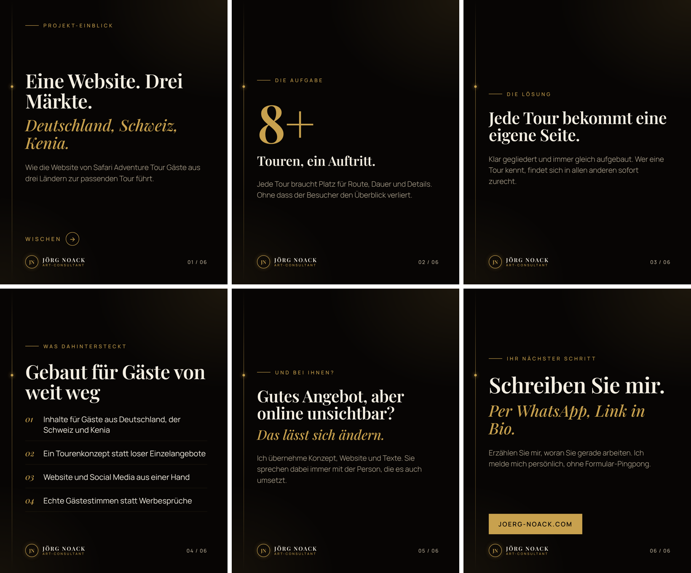

# Instagram-Agent – hochwertige Posts für die Webseiten-Erstellung

Ein KI-Agent, der fertige Instagram-Posts zu deinem Angebot **hochwertige Webseiten** erstellt:
Folien als PNG (1080×1350, 4:5-Hochformat), Caption, Hashtags, Alt-Text und Posting-Tipp –
und auf Wunsch **jeden Tag automatisch einen Beitrag plus Stories veröffentlicht** ([→ Tägliche Automatik](#tägliche-automatik-beitrag--stories)).




## So arbeitet der Agent

```
Thema ──► 1. Entwurf (Claude, Texter-Rolle)
              │
              ▼
          2. Automatische Prüfung ──── Zeichengrenzen, Folienaufbau, Hashtags, KI-Floskeln,
              │                         heikle Werbeaussagen (UWG), Text-Überlauf im echten Layout
              ▼
          3. Creative-Director-Review ── Note 1–10 + überarbeitete Fassung
              │
              └── wiederholen, bis Note ≥ 9 und 0 Mängel (max. 3 Runden)
              ▼
          4. Rendern ──► ausgabe/<datum>-<thema>/ folie-1.png … caption.txt
```

- **Faktenquelle ist nur `marke.json`.** Der Agent erfindet keine Kundenzahlen, Preise oder Bewertungen.
- **Verlauf:** Jeder Post landet in `ausgabe/verlauf.json`, damit sich Themen und Hooks nicht wiederholen.
- **Design** wie joerg-noack.com: Schwarz und Gold, Überschriften in Playfair Display, Text in Manrope. Schriften sind lokal eingebettet, funktionieren also offline.
- **Inhalte** von joerg-noack.com: echte Referenzen (Diani Home Hosting, Safari Adventure Tour, Security Factory, Saiko Tour & Safaris), Leistungen, Tonalität. Schwerpunkt Webdesign.

## Einrichtung (einmalig)

```bash
cd marketing/insta-agent
npm install
npx playwright install chromium
```

API-Schlüssel von https://platform.claude.com → *API Keys*:

```bash
export ANTHROPIC_API_KEY="sk-ant-..."
```

Unter Windows (PowerShell): `$env:ANTHROPIC_API_KEY="sk-ant-..."`

## Benutzung

Post zu einem Thema:

```bash
node agent.js --thema "5 Fehler, die Ihre Website Kunden kosten"
```

Einzelbild statt Karussell, mit eigenen Hinweisen:

```bash
node agent.js --thema "Baukasten vs. programmiert" --format einzelbild --notizen "Zielgruppe Handwerker"
```

Agent wählt selbst ein frisches Thema:

```bash
node agent.js --auto
```

Redaktionsplan mit 12 Ideen (Markdown mit fertigen Befehlen):

```bash
node agent.js --plan 12
```

Layout testen ohne API-Key:

```bash
node agent.js --demo
```

| Option | Bedeutung | Standard |
|---|---|---|
| `--thema`, `-t` | Worum es im Post geht | – |
| `--format`, `-f` | `karussell` oder `einzelbild` | `karussell` |
| `--folien` | Gewünschte Folienzahl (5–8) | 6–7 |
| `--notizen`, `-n` | Zusatzinfos (Aktion, Branche, Anlass …) | – |
| `--runden` | Max. Überarbeitungsrunden | `3` |
| `--zielnote` | Ab dieser Note ist der Post fertig | `9` |

Modell ändern (Standard `claude-opus-5-5`): `INSTA_AGENT_MODEL=claude-sonnet-5-5 node agent.js …`

## Ergebnis

```
ausgabe/2026-11-08-5-fehler-die-ihre-website-kunden-kosten/
├── folie-1.png … folie-6.png   → direkt bei Instagram hochladen
├── caption.txt                 → Caption + Hashtags zum Kopieren
├── README.md                   → alles auf einen Blick, inkl. Alt-Text und Posting-Tipp
├── post.json                   → Rohdaten (zum Nachbearbeiten)
├── folie-1.jpg …               → JPEG-Fassung (für die Instagram-API)
└── folie-vorschau.html         → alle Folien im Browser ansehen
```

Eigene Änderungen: `post.json` bearbeiten und neu rendern:

```bash
node agent.js --rendern ausgabe/2026-11-08-…/post.json
```

## Veröffentlichen über Windsor.ai (aktueller Betrieb)

Gepostet wird **nicht** mit `taeglich.js`, sondern über den bestehenden Windsor.ai-Weg auf dem Branch
`claude/instagram-agent` (Konto **@flowkit5**, keine Meta-App und kein Token nötig):

| Uhrzeit (Berlin) | Geplante Aufgabe | Inhalt |
|---|---|---|
| 11:32 | Instagram-Agent Back Office | Back-Office-Beitrag + Story aus `posts.json` |
| 17:34 | Instagram-Agent Webdesign | Webdesign-Karussell/Einzelbild + Story aus `posts-webdesign.json` |

Dieser Ordner ist die **Content-Fabrik** für den Webdesign-Strang:

1. Neue Beiträge in `webdesign-bank.json` ergänzen (gleiches Format wie die vorhandenen, IDs fortlaufend W13, W14 …).
2. Prüfen und rendern direkt in den Veröffentlichungs-Ordner (Checkout von `claude/instagram-agent`):

   ```bash
   node bank-bauen.js /pfad/zu/claude-instagram-agent/marketing/instagram-agent
   ```

3. Dort committen und auf `claude/instagram-agent` pushen. Bereits gepostete IDs (`posted-webdesign.json`) werden nicht erneut gepostet.

`taeglich.js` bleibt als Alternative für einen eigenen Server bestehen. **Nicht zusätzlich einschalten**, sonst wird doppelt gepostet.

## Projekt-Screenshots

Echte Projekte verkaufen besser als jede Behauptung. Der Folientyp **„projekt“** zeigt eine Kunden-Website im Browserfenster plus Handy-Ansicht – in Stories nur das Handy.

```bash
node screenshots.js
```

```bash
node screenshots.js safari-adventure-tour
```

- Fotografiert alle Projekte aus `marke.json` (`referenzen` und `projekte_in_arbeit`, jeweils mit `url` und `kuerzel`) als Desktop (1440×900) und iPhone-Ansicht.
- Cookie-Banner werden weggeklickt oder ausgeblendet, Seiten, die Inhalte erst beim Scrollen zeigen, werden durchgescrollt.
- Ergebnis: `projekte/<kuerzel>/desktop.jpg` und `mobil.jpg` – eingecheckt, damit der Server beim Posten nicht fremde Websites abrufen muss.
- **Jedes Bild einmal ansehen**, bevor es online geht. Nach Änderungen an einer Kunden-Website einfach neu fotografieren.
- Neues Projekt: in `marke.json` mit `name`, `kuerzel`, `url`, `branche`, `leistung` eintragen, `node screenshots.js <kuerzel>` ausführen. Der Agent kennt es ab dann automatisch.

## Tägliche Automatik: Beitrag + Stories

`taeglich.js` erledigt jeden Tag alles allein:

| Uhrzeit (deutsche Zeit) | Was passiert |
|---|---|
| ca. 07:20–07:40 | Thema wählen → Beitrag schreiben, prüfen, überarbeiten → rendern → **im Feed veröffentlichen** |
| ca. 12:10–12:30 | 2 Story-Frames: Teaser auf den Beitrag vom Morgen + ein Praxistipp → **als Story veröffentlichen** |

**Sicherheitsnetze**

- **Qualitätsschranke:** Bleiben Mängel offen oder liegt die Note unter `MINDESTNOTE` (Standard 8), wird **nicht** gepostet. Der Entwurf landet in `ausgabe/`, und du bekommst eine Meldung.
- **Keine Doppel-Posts:** Pro Tag höchstens ein Beitrag und eine Story-Runde, auch wenn der Job mehrmals läuft (`ausgabe/zustand/veroeffentlicht.json`).
- **Bild-Check:** Vor dem Posten wird geprüft, ob die Bilder öffentlich als JPEG erreichbar sind.
- **Token läuft nicht ab:** Das Instagram-Token (60 Tage gültig) wird automatisch wöchentlich erneuert.
- **Push aufs Handy (optional):** Mit der App [ntfy](https://ntfy.sh) bekommst du nach jedem Lauf eine Nachricht: online, abgelehnt oder Fehler.

**Themen steuern:** `warteschlange.txt` (Vorlage: `warteschlange.beispiel.txt`), eine Zeile pro Thema, die oberste wird gepostet und dann entfernt. Ist die Liste leer, wählt der Agent selbst aus den Themen-Säulen in `marke.json`. Mit `node agent.js --plan 30` bekommst du in `ausgabe/plan-themen.txt` Futter für einen ganzen Monat.

### 1. Instagram einrichten (einmalig, ca. 20 Minuten)

Die Veröffentlichung läuft über die **offizielle Instagram-API** (kein Passwort-Login, kein Sperr-Risiko durch Bots).
Meta ändert die Oberfläche öfter. Halte dich an die Schritte sinngemäß, falls Menüs anders heißen.

1. **Profi-Konto:** In der Instagram-App → Einstellungen → *Kontotyp und Tools* → auf **Business-Konto** umstellen (Stories per API gehen nur mit Business-Konten).
2. **Meta-App anlegen:** [developers.facebook.com/apps](https://developers.facebook.com/apps) → *App erstellen* → Anwendungsfall **„Nachrichten und Inhalte auf Instagram verwalten“** (Instagram-API) → App-Typ *Business*.
3. In der App: **Instagram → API-Einrichtung mit Instagram-Login** → *Konto hinzufügen* → mit deinem Instagram-Konto anmelden und die Berechtigungen `instagram_business_basic` und `instagram_business_content_publish` erlauben.
4. Dort **„Token generieren“** klicken → das lange Token (beginnt meist mit `IGAA…`) kopieren → in die Konfiguration als `INSTAGRAM_ACCESS_TOKEN`.
5. Falls die Anmeldung scheitert: unter *App-Rollen → Rollen* dein Instagram-Konto als **Instagram-Tester** hinzufügen und die Einladung in Instagram unter *Einstellungen → Apps und Websites → Tester-Einladungen* annehmen.

Die App kann im Entwicklungsmodus bleiben, solange sie nur dein eigenes Konto bedient. Eine App-Prüfung durch Meta ist dafür in der Regel nicht nötig.

### 2. Bilder öffentlich bereitstellen

Instagram lädt die Bilder selbst von einer **öffentlichen https-Adresse** herunter. Zwei Wege:

- **A – eigener Server (empfohlen, wenn das Back Office schon auf deinem VPS läuft):** Das Einrichtungsskript legt `/var/lib/insta-agent/public` an. In `/etc/caddy/Caddyfile` ergänzen:

  ```caddyfile
  office.joerg-noack.com {
  	encode gzip
  	handle_path /insta/* {
  		root * /var/lib/insta-agent/public
  		file_server
  	}
  	handle {
  		reverse_proxy 127.0.0.1:3000
  	}
  	header Strict-Transport-Security "max-age=31536000; includeSubDomains"
  }
  ```

  ```bash
  sudo systemctl reload caddy
  ```

  Dann `BILD_BASIS_URL=https://office.joerg-noack.com/insta`.

- **B – Cloudflare R2 (ohne eigenen Server, großzügiges Gratiskontingent):** Bucket anlegen, *Public access* einschalten (r2.dev-Adresse oder eigene Domain), API-Token erstellen und `BILD_HOSTING=s3` sowie die `S3_…`-Werte setzen (siehe `.env.beispiel`).

Die Bild-Ordner bekommen zufällige Namen, sind also vor der Veröffentlichung nicht erratbar.

### 3a. Auf dem eigenen Server (Linux, empfohlen)

Repository auf den Server holen, dann:

```bash
cd marketing/insta-agent
```

```bash
sudo bash deploy/einrichten.sh
```

Das Skript legt einen eigenen Systembenutzer an, installiert alles nach `/opt/insta-agent`, Chromium zum Rendern, und die beiden Zeitpläne (systemd-Timer). Danach:

```bash
sudo nano /etc/insta-agent.env
```

```bash
sudo insta-agent --pruefen
```

```bash
sudo insta-agent --trocken
```

```bash
sudo systemctl enable --now insta-agent-feed.timer insta-agent-story.timer
```

Nützliche Befehle:

| Zweck | Befehl |
|---|---|
| Nächste Läufe anzeigen | `systemctl list-timers 'insta-agent*'` |
| Protokoll ansehen | `journalctl -u 'insta-agent@*' -n 100` |
| Sofort einen Beitrag posten | `sudo insta-agent --nur feed` |
| Themen bearbeiten | `sudo nano /var/lib/insta-agent/warteschlange.txt` |
| Automatik pausieren | `sudo systemctl disable --now insta-agent-feed.timer insta-agent-story.timer` |
| Update nach `git pull` | `sudo bash deploy/einrichten.sh` |

Uhrzeiten ändern: `sudo systemctl edit insta-agent-feed.timer` → unter `[Timer]` zuerst `OnCalendar=` (leer) und dann z. B. `OnCalendar=*-*-* 18:00:00 Europe/Berlin` eintragen.

### 3b. Auf dem eigenen Rechner (Windows/Mac)

Funktioniert genauso, solange der Rechner zur Posting-Zeit an ist. `.env.beispiel` nach `.env` kopieren und ausfüllen, dann:

```bash
node taeglich.js --pruefen
```

```bash
node taeglich.js --trocken
```

Zeitplan unter Windows: *Aufgabenplanung* → Aufgabe erstellen → täglich 07:30 → Aktion „Programm starten“: `node`, Argumente `taeglich.js`, Starten in: `…\marketing\insta-agent`.
Unter macOS/Linux per `crontab -e`:

```
30 7 * * * cd /pfad/zu/marketing/insta-agent && node taeglich.js >> ausgabe/automatik.log 2>&1
```

### Alle Optionen von `taeglich.js`

| Option | Bedeutung |
|---|---|
| `--pruefen` | Token, Konto, Posting-Kontingent und Bild-Hosting testen. Postet nichts. |
| `--trocken` | Beitrag + Stories erzeugen, aber nichts hochladen/veröffentlichen |
| `--nur feed` / `--nur story` | Nur einen Teil ausführen (so arbeiten die beiden Timer) |
| `--stories 3` | Anzahl Story-Frames (1–5, Standard `STORIES_PRO_TAG` bzw. 2) |
| `--mindestnote 8` | Qualitätsschranke |
| `--erzwingen` | Heute trotzdem noch einmal posten |

Grenzen der API: Umfrage-, Link- und Musik-Sticker lassen sich in Stories nicht automatisch setzen. Die Stories arbeiten deshalb mit Text-Hinweisen („Link in Bio“, „Schreiben Sie mir“). Instagram erlaubt 50 API-Veröffentlichungen pro 24 Stunden, der Agent braucht 3 pro Tag.

### Tests

```bash
npm test
```

Spielt Hosting, Token-Erneuerung sowie Karussell- und Story-Veröffentlichung gegen einen nachgebauten Instagram-Server durch, ohne Konto und API-Key.

## Anpassen

- **`voice.md`** – dein Stimm-Profil: wie du klingst, deine Positionen, Tabus und **echte Belege** (Zahlen, Kundenergebnisse).
  Der Agent und die Instagram-Skills (`/ig-reel`, `/ig-caption` …) lesen dieselbe Datei. Unausgefüllte `{{…}}`-Platzhalter werden ignoriert.
  Damit die Skills sie finden, einmalig verlinken:

  ```bash
  mkdir -p ~/.claude/instagram && ln -sfn "$PWD/voice.md" ~/.claude/instagram/voice.md && ln -sfn "$PWD/swipe.md" ~/.claude/instagram/swipe.md
  ```

  Unter Windows stattdessen die Datei nach `%USERPROFILE%\.claude\instagram\voice.md` kopieren.
- **`marke.json`** – Angebot, Leistungen, USPs, Zielgruppe, Tonalität, CTAs, Themen-Säulen, Farben.
  Je konkreter und ehrlicher, desto besser die Posts. Echte Referenzen/Kundenstimmen hier eintragen, dann nutzt der Agent sie.
- **`src/pruefung.js`** – harte Regeln (Zeichengrenzen, verbotene Aussagen).
- **`src/floskeln.de.json`** – deutsche KI-Floskeln und -Satzmuster („maßgeschneidert“, „Mehrwert“, „nicht nur …, sondern auch …“, „Das Ergebnis?“ …).
  Jeder Treffer geht als Mangel zurück an Claude und wird umgeschrieben. Dieselbe Liste nutzt der Skill `/ig-human` (`.claude/skills/ig-human/slop.de.json`).
  Beim Erweitern beide Dateien ändern, `npm test` prüft, ob sie übereinstimmen.
- **`src/render.js`** – Folien-Design (CSS).

## Kosten

Ein Post braucht 4–7 API-Aufrufe (Entwurf + bis zu 3 Review-Runden). Das Markenprofil wird per Prompt-Caching
wiederverwendet, das senkt die Kosten der Folgeaufrufe. Aktuelle Preise: https://claude.com/pricing
